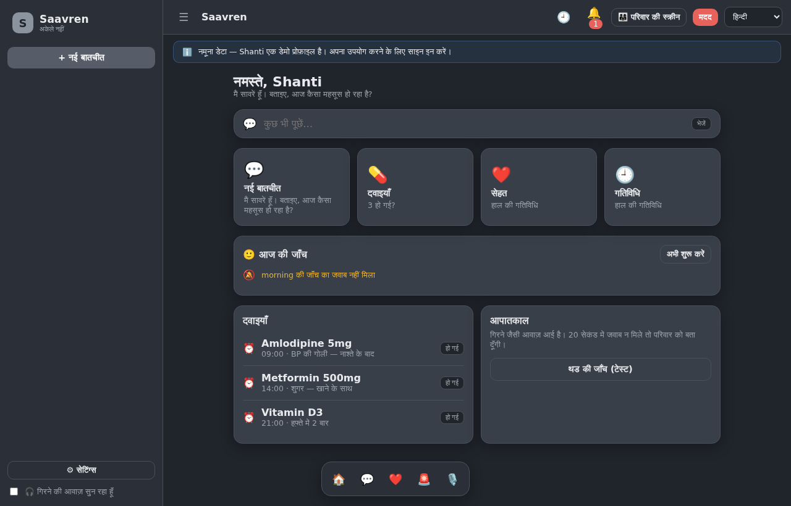
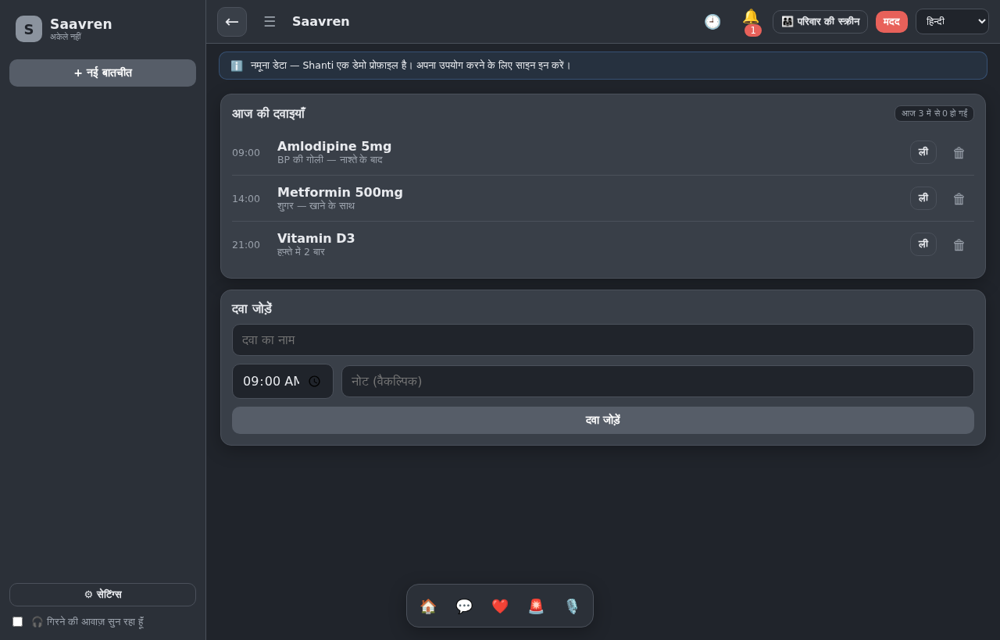
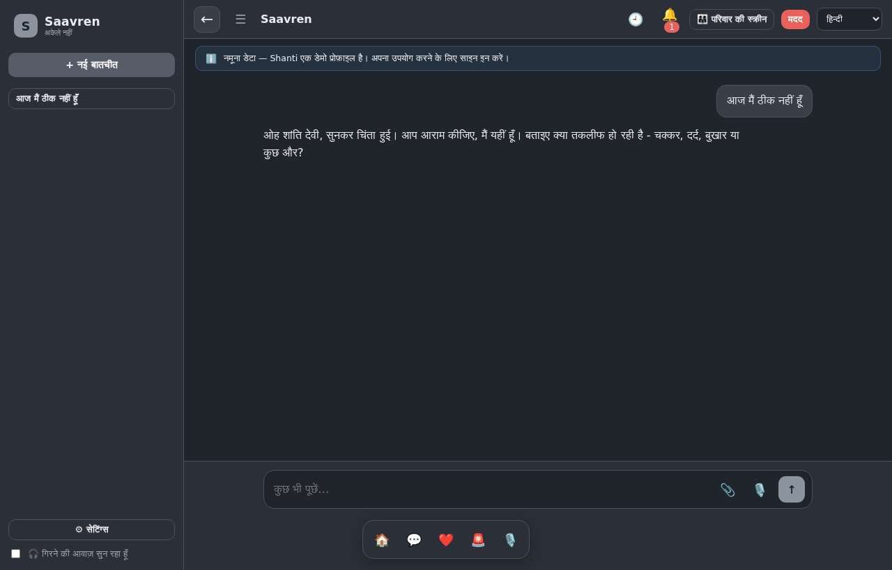
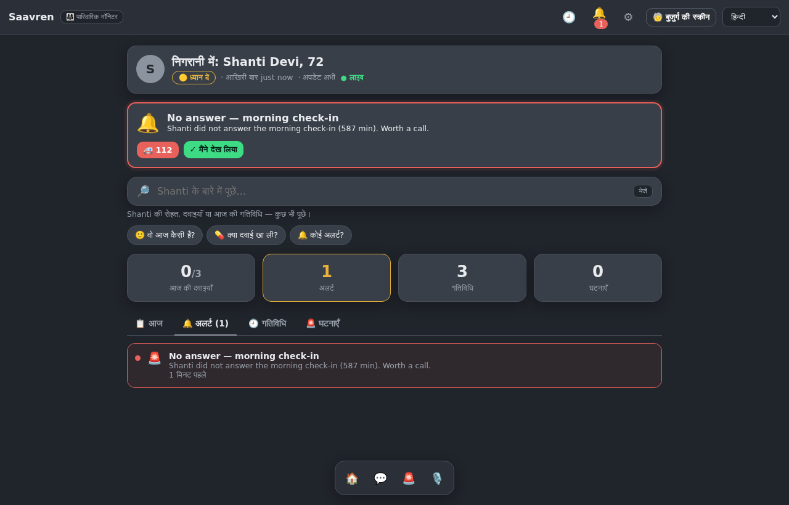
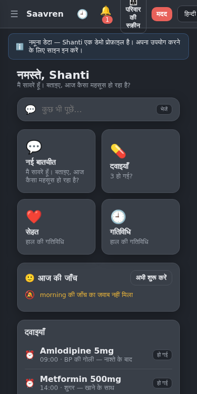
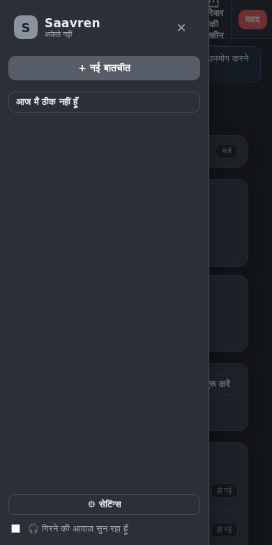

---
title: Saavren
emoji: 🧓
colorFrom: indigo
colorTo: purple
sdk: docker
app_port: 7860
short_description: A voice-first guardian and daily health companion for elders living alone.
---

# Saavren — You are not alone

**A voice-first guardian and daily health companion for elderly people living alone.**

Built for the **Meta Global AI Developer Hackathon 2026** (Oct 26 – Nov 4), Indie track.

An elder living alone does not need another chatbot. They need something that
notices when the morning check-in never came, that hears "I have fallen" and
knows what to do, and that tells a daughter three cities away that her mother's
blood pressure has been climbing all week. Saavren is that layer — voice-first,
because the person who needs it most will not type.

---

## Try it

| | |
| --- | --- |
| **Live demo** | <https://saavren.onrender.com> — opens in any browser, nothing to install |
| **Android APK** | [Download the APK](https://github.com/OMtheMAKER/saavren/releases/latest) — Android 7.0+, allow "Unknown sources" |
| **Demo video** | [Watch the walkthrough (1:42)](https://youtu.be/QSggmFeMxTk) |

The live demo and the APK run the same build. Render's free tier sleeps when
idle, so give the first load about 30 seconds to wake up.

---

## Screenshots

Real captures of the live deployment — <https://saavren.onrender.com>. These
are the Hindi UI; the same screens run in nine languages, and the language
switch moves the labels, the AI's replies and the spoken voice together.

| Home & check-ins | Medicines |
| --- | --- |
|  |  |

| Companion chat | Family monitor |
| --- | --- |
|  |  |

| Phone — home | Phone — drawer |
| --- | --- |
|  |  |

---

## Run it

One command. No Docker, no Node toolchain, no system packages.

```bash
python run.py          # Windows: use  py run.py  if 'python' is not on PATH
```

`run.py` creates the virtualenv, installs dependencies once, seeds `.env` from
`.env.example`, tells you which API keys it found, picks the first free port
(so a stale server can never keep serving old code), and opens
`http://localhost:8000`.

Docker is supported too: `docker compose up --build`.

**It works with zero API keys.** Add keys and the AI gets better; add none and
the app still runs every screen on a rule-based offline mirror. See
[Graceful degradation](#graceful-degradation).

---

## What it does

### 🆘 Emergency
- **One-tap SOS** → escalation chain through the family contact list → hospital packet with the nearest three hospitals (OpenStreetMap Nominatim, haversine-sorted).
- **"I have fallen" voice SOS** — spoken, no hands, no screen reading.
- **Fall-sound detection** — the microphone listens for the thud signature of a fall and opens a countdown the elder can cancel. Nothing is recorded or uploaded; only the acoustic signature is analysed.
- **Emergency Card** — a printable one-pager carrying blood group, conditions, medicines and contacts, for a stranger or a paramedic.

### 🩺 Health, daily
- **Medicines** — a real screen: dose counter, time-sorted rows, mark-taken, add, delete. The daily routine is *derived* from the medicines, so a new medicine needs no second entry anywhere.
- **Sehat Board** — BMI, vitals history, weekly adherence points.
- **Vitals** logged and charted (BP, sugar, SpO₂, pulse, weight, temperature).
- **Mini-triage** — "my head is hurting" produces 1–2 conversational follow-ups, then safe home care and red flags to watch. Severity ≥ 7 or any red flag offers to call the doctor. Always closes with the not-a-doctor disclaimer.

### 🌞 Companion
- **Proactive check-ins** — the app starts these itself, twice a day by default: **morning (09:00) and evening (21:00)**. Each one opens with three spoken questions in her language and she answers by voice. The schedule is editable per elder, and the slot engine takes any list — the design spec called for four slots (wake, noon, evening, bedtime) and the shipped demo runs two. It never interrupts a conversation, an alarm, or an open emergency.
- **Day journal** — every reply runs through a sentiment/state extractor into `{time, mood, health_note, topics}`.
- **9 PM digest** — the day is composed into a summary and pushed to the family's alerts feed.

### 👨‍👩‍👧 Family monitor
A separate seat with read-only context: check-ins, medicines, alerts, vitals, incidents. One tap to switch.

### 🤖 The agent
Operates every feature on the elder's behalf — or the elder can do it by hand; both write to the same store, and the agent always confirms. **Attachment scanning**: photograph a medicine strip or a prescription and it reads it (`POST /api/scan`, multimodal — the reasoning model is multimodal, so no separate OCR service is needed).

---

## The AI, and why it never hard-fails

Two Meta open-weight models. Which one actually runs on the live demo:

| Job | Model |
|---|---|
| Speech → text | **Meta MMS** `facebook/mms-1b-all` via the HF router <br>*(wired; inactive without an HF token — Groq whisper carries the live demo)* |
| Reasoning | **Muse Spark Open** `meta-models/muse-spark-open` (816B-A42B MoE, multimodal) on Baseten <br>*(live — `/api/ai-status?probe=1` reports Baseten OK)* |

Each has a fallback chain that is exercised, not theoretical:

```
reasoning : Baseten (Muse Spark Open) → Groq (gpt-oss-120b → qwen3.6-27b → gpt-oss-20b)
          → HF router (opt-in; free accounts have no provider credits) → offline mirror
speech    : MMS via HF router (inactive: needs HF provider credits)
          → Groq whisper-large-v3-turbo (what the live demo uses)
          → browser Web Speech API
```

### Graceful degradation

This is the part the demo should show. With **no keys at all**:

- the agent answers from a rule-based offline mirror, stamped `source: "offline-fallback"` so nobody mistakes it for a model's answer;
- voice input falls through to the browser's own speech recognition;
- every other screen — medicines, vitals, routine, SOS, emergency card, family monitor — works exactly as it does with keys;
- `GET /api/ai-status?probe=1` names the failing provider, the HTTP status, and the models your key can actually reach.

### Voice with nothing to install

Audio is encoded to WAV **in the browser**. There is no `ffmpeg`, no
`winget`, no `choco`, no admin prompt, and no audio leaves the machine except
the bytes being transcribed. A Windows user clones the repo and runs one
command.

---

## Multilingual

Nine languages, switchable at any moment: **Hindi · English · Bengali · Tamil ·
Telugu · Marathi · Gujarati · Spanish · French**.

265 UI strings × 9 languages. Switching language moves the UI, the agent's
replies, the spoken output and the date/number formatting together — the
`lang` is threaded to the backend with every request so the AI replies in the
language on screen.

---

## Accounts, and privacy

- **Local SQLite.** No cloud database, no hosted auth, no card.
- **Login is optional.** The app is fully usable signed out; signing in ties an
  account to a person. It does **not** yet pair an elder with their family —
  there is no invite step, so both roles read the same store (below).
- **Two roles at signup** — elder and family — which decide which view you land on.
- Passwords hashed with stdlib `hashlib.scrypt`, not bcrypt/passlib — it needs
  no compiler on the user's Windows box and, unlike `audioop` and friends, is
  still present on Python 3.14. Per-user salts, constant-time compare.
- Sessions are JWTs; changing a password revokes every other session for that
  user.
- **Accounts are the only per-user data.** The profile, medicines, check-ins,
  alerts and incidents live in one server-wide in-memory store — every session
  sees the same demo data, and it resets when the server restarts. That is
  single-tenant by design for a demo, not a privacy boundary. Splitting the
  store per user is the next commit, not a missing feature.

---

## Stack

FastAPI · React + Vite · SQLite · Groq whisper ASR · Muse Spark Open on Baseten ·
Groq model fallback · browser `speechSynthesis` for voice output · Meta MMS ASR
(wired, inactive without an HF token)

52 API endpoints. ~4,300 lines of backend Python.

---

## Testing

```bash
cd backend && python -m pytest tests -q     # 243 passed
cd frontend && npm run lint && npm run build
```

`npm run build` **runs ESLint first with `no-undef` on**, so an undeclared
variable fails the build instead of shipping as a blank screen at runtime —
the one class of bug a bundler cannot see. (This guard exists because it bit
us: `MonitorView` used `lang` without ever declaring it in its props, Vite
bundled it happily, and it only crashed on the family monitor.)

---

## Layout

```
run.py                  one-command launcher
backend/app/            ai.py (model chains) · auth.py · main.py (52 endpoints)
backend/tests/          243 tests
frontend/src/           App.jsx · components/ · lib/i18n.js (265 keys × 9)
docs/WORKING.md         the full feature blueprint and build log
docs/images/            the screenshots above
```

---

## Honest limits

- **Two check-in slots ship, not four.** `CHECKIN_KINDS` is
  `("morning", "evening")` with slots at 09:00 and 21:00; the design spec
  described four (wake, noon, evening, bedtime) and the one-minute tour video
  says "four times a day". The contract is a list, so adding noon and bedtime
  is data, not code — but the shipped demo runs two, and this file should say so.
- Fall detection is **acoustic**, tuned for the thud of a fall. It is a safety
  net, not a medical device, and it does not replace a wearable.
- The agent's medical guidance is explicitly not a doctor's advice; every
  health answer says so.
- **Meta MMS never runs on the live demo.** The ASR chain tries
  `facebook/mms-1b-all` first only when `HF_TOKEN` is set **and** the account has
  Inference Provider credits — free HF accounts get none, and the providers the
  router would use are paid. With no token the chain *skips* MMS silently, it
  does not fail over to it: `/api/health` on the live site reports
  `asr_chain: ["groq"]` and `hf_token: "missing"`.
- **Emergency dispatch is simulated.** An SOS or an unanswered fall raises an
  alert, writes it to the family feed and builds the hospital packet with the
  nearest three hospitals. It does not place a call, send an SMS or fire a
  webhook, and the app does not claim on screen that it did.
- Muse Spark Open does not support structured JSON output on Baseten, so the
  model layer parses leniently and validates rather than assuming a schema.
- Voice output uses the browser's `speechSynthesis`, so the voice quality
  depends on the OS voices installed.

---

## What is real, and what is simulated

Built and runs today:

- Accounts — signup, login, scrypt password hashing, JWT sessions, session
  revocation on password change, stored in SQLite.
- Acoustic fall detection on the live microphone stream, with an "are you OK?"
  countdown the elder can cancel.
- The triage conversation — spoken input transcribed by Groq
  whisper-large-v3-turbo, reasoning by Muse Spark Open on Baseten with a Groq
  model fallback, and spoken replies.
- Medicine schedule, check-ins, adherence points and the incident timeline,
  held in one in-memory store.
- The hospital packet — nearest three hospitals from OpenStreetMap Nominatim,
  haversine-sorted, with a static offline list if the network is down.

Simulated on purpose:

- Emergency dispatch. Nothing leaves the server. See Honest limits.
- The shared demo store above.

Wired but inactive:

- Meta MMS `facebook/mms-1b-all` — the ASR chain tries it first when
  `HF_TOKEN` is set **and** the account has Inference Provider credits. Neither
  is true on the demo deployment, so the chain skips it silently and Groq
  whisper carries every transcription.

Not built, though `docs/WORKING.md` describes it: OTP login, invite codes,
bcrypt, and the friend-mode small talk. That file is a blueprint, not a
changelog — it is marked as one.

---

## License

MIT — see [LICENSE](LICENSE). Copyright © 2026 Om Pratap Singh.
